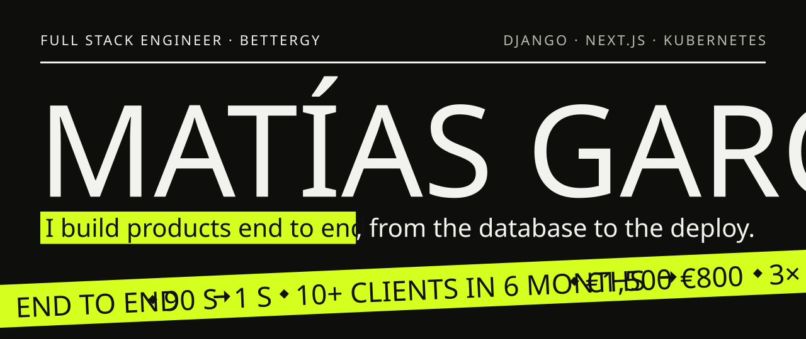
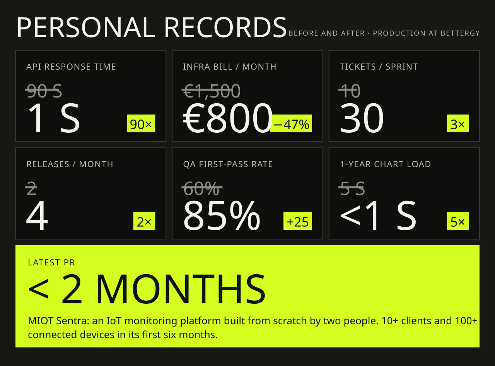
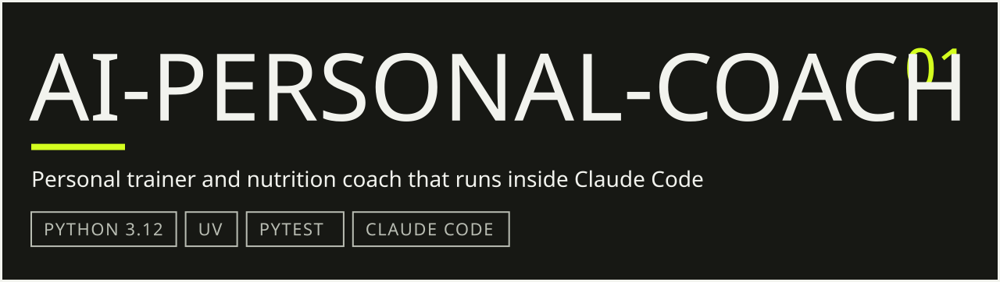
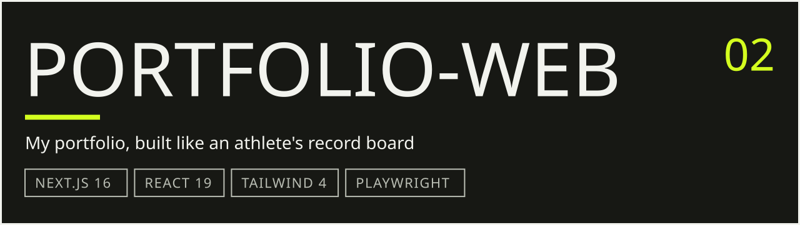

<a href="https://matiasgarcia.dev">
  <picture>
    <source media="(max-width: 600px)" srcset="assets/header-narrow.svg">
    
  </picture>
</a>

**Full Stack Engineer at Bettergy, an energy-tech product company.** Django and PostgreSQL on the back, Next.js and TypeScript on the front, Docker and Kubernetes to run it, and Claude Code in the loop to ship faster without dropping quality.

I lead a team of five technically (architecture, code reviews, standards), and the three juniors I onboarded each shipped to production in their first month.

<picture>
  <source media="(max-width: 600px)" srcset="assets/records-narrow.svg">
  
</picture>

How those numbers happened:

- **MIOT Sentra**, an IoT monitoring platform for energy installations, built from scratch with one other developer and live in under two months. Its time series run on TimescaleDB hypertables, which took a 1-year chart from ~5 s to under a second.
- **Claude Code workflow** with tickets of two days or less: about 10 → 30 tickets per two-week sprint, testing and QA included.
- **Linters, formatters and strict test rules**: releases went from twice a month to once or twice a week.
- **Django ORM rewrite** on a core endpoint: from up to 6,000 database calls per request down to 7.
- **Automated cleanup of stale Velero backups** on Kubernetes, worth about €8,400 a year.

## Featured projects

<a href="https://github.com/matgarfer499/ai-personal-coach">
  <picture>
    <source media="(max-width: 600px)" srcset="assets/ai-personal-coach-narrow.svg">
    
  </picture>
</a>

For healthy adults who want a lasting change in body and health. Claude does the conversation; every number (calories, macros, heart-rate zones, loads, weight trend) comes from a tested Python CLI, so the model never does the maths in its head. Every piece of advice traces back to one of 469 graded rules backed by 890 sources, and safety flags from the health screening are enforced in code.

**[Repository →](https://github.com/matgarfer499/ai-personal-coach)**

 

<a href="https://github.com/matgarfer499/portfolio-web">
  <picture>
    <source media="(max-width: 600px)" srcset="assets/portfolio-web-narrow.svg">
    
  </picture>
</a>

A sports-poster portfolio for engineers and clients who want the numbers first; this page borrows its look. Every section is server-rendered and readable without JavaScript, all motion is CSS and stops with `prefers-reduced-motion`, and feature folders never import each other (ESLint enforces it). There are six hidden trophies if you go looking.

**[Live site →](https://matiasgarcia.dev)** · **[Repository →](https://github.com/matgarfer499/portfolio-web)**

## Stack

**Product / frontend** &nbsp;`TypeScript` `React` `Next.js` `Tailwind CSS` `SvelteKit`

**Backend / data** &nbsp;`Python` `Django` `Django REST Framework` `FastAPI` `Celery` `Redis` `PostgreSQL` `TimescaleDB`

**Infra** &nbsp;`Docker` `Kubernetes` `GitLab CI` `Flux` `Grafana` `Prometheus` `Loki` `Sentry`

**AI tooling** &nbsp;`Claude Code`, every day: skills, hooks and a test-first workflow

## Contact

[LinkedIn](https://www.linkedin.com/in/mgarfer/) · [mjgarciadev14@gmail.com](mailto:mjgarciadev14@gmail.com) · [matiasgarcia.dev](https://matiasgarcia.dev)

